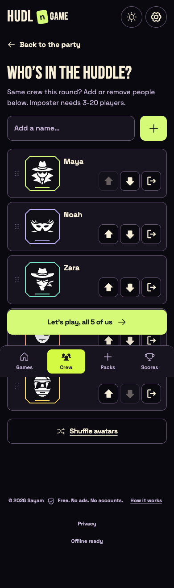
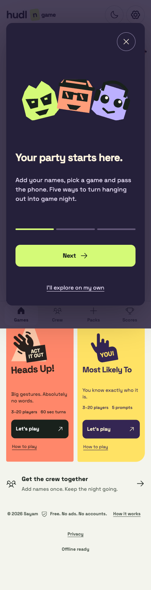
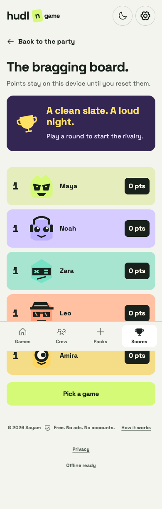

<div align="center">

# hudl n game.
### Good company. Bad alibis.

**One phone. Five games. Everyone in.**

[Play now](https://sayamdev.github.io/hudl-n-game/) · [How it works](#one-phone-a-whole-party) · [Run locally](#make-it-yours) · [AI setup](docs/pack-studio-setup.md)

Free to play · No accounts · No ads · Phone-first

</div>


## One phone. A whole party.

Add your crew, choose a game and pass the phone. A short interactive welcome lets new players practise holding to reveal a secret before the real round begins. Names, scores and custom packs stay on the device.

| Your kind of chaos | The game | Crew |
| --- | --- | --- |
| A word everyone knows. Almost everyone. | **Imposter** — secret words, clues, accusations and a last-chance guess. | 3–20 |
| Trust nobody after dark. | **Mafia** — narrated nights, secret roles and village votes. | 5–20 |
| Same place. One very lost spy. | **Where Are We?** — location clues, questioning and a hidden outsider. | 3–20 |
| Big gestures. Absolutely no words. | **Heads Up!** — team charades against the clock, with correct and skip controls. | 3–20 |
| You know exactly who it is. | **Most Likely To / Hot Takes** — point votes or private agreement ratings. | 3–20 |

## A little character. A lot of replay.

<table>
<tr>
<td width="33%"></td>
<td width="33%"></td>
<td width="33%"></td>
</tr>
<tr><td><b>Your cast.</b> Twenty alibi identities, saved names and easy lineup changes.</td><td><b>Learn by doing.</b> Try the secret reveal, then bring your crew in.</td><td><b>Keep the rivalry.</b> Local scores with ties that share the spotlight.</td></tr>
</table>

- **Five visual worlds:** acid-green suspicion, midnight Mafia, a green spy world, coral charades and a yellow-and-purple voting party.
- **Private reveals:** hold to peek; release or switch away to hide. A returning game resumes paused.
- **Less repetition:** local play history helps rotate words, prompts and secret roles. Small pools can still repeat; this is not a promise of endless unique content.
- **Make your own night:** mix curated words offline, write an original pack, or import one with a link or QR code. Review shared content before playing.
- **Browser comfort:** large touch controls, keyboard paths, reduced motion, light/dark modes, optional sound and installable PWA support. Once cached, the core games work offline.
- **Choose your look:** the earlier designs remain available in Settings.

## Play with touch, tilt or keyboard

In **Heads Up!**, choose **Enable tilt controls** before starting and allow motion access if your browser asks. Practise on the ready screen: hold upright, tip the screen toward the floor for Correct, or toward the ceiling to Skip. Return upright between gestures. Practice does not add points; touch controls remain available if sensors are unsupported or permission is denied.

- **Tab / Shift+Tab:** move between controls; **Enter / Space:** activate a button.
- **Hold Space or Enter on Hold to peek:** reveal your secret; release to hide it immediately.
- **→ / ← in Heads Up!:** Correct / Skip.
- **Esc:** pause a game; dismiss the pause dialog to resume.

Motion support depends on the device and browser. Sensor behaviour is covered by simulated browser events; physical iOS/Android verification is still needed. [Control design and API references](docs/adr/0004-phone-tilt.md).

## Make it yours

Use Node.js 22.12 or newer.

```sh
npm ci
npm run dev
```

For a production preview:

```sh
npm run build
npm run preview
```

Open the URL printed by Vite. Use its Network URL for a phone on the same Wi-Fi. Features such as service workers, device motion and wake lock depend on browser support and may require HTTPS.

### Optional AI, with a review step

The **public GitHub Pages demo uses the offline mixer and manual packs**. It does not expose an API key or run a generation server.

For local AI generation, copy `.env.example` to `.env.local`, add your own Groq key and confirm the account's free-tier configuration. Restart Vite. The server adapter requests a themed draft, validates it and returns it for you to edit before saving. Your crew names and scores are not included in the request.

The adapter has small in-memory usage caps and no paid fallback. Provider availability and free quotas can change. A public AI service needs separate server hosting and durable abuse controls; see the [setup and deployment notes](docs/pack-studio-setup.md). Never put secrets in a `VITE_` variable or commit `.env.local`.

## Under the hood

**React · TypeScript · Vite · Zustand · Motion · Lottie · Playwright · Vitest**

Lazy-loaded game screens share a typed session store. Content and scores persist locally; bounded variety history influences future rounds. The optional Node server keeps provider credentials out of browser bundles. The PWA caches the static app, not AI responses.

```sh
npm test                 # Game logic, content and variety
npm run test:server      # Provider adapter validation and limits
npm run test:e2e         # Production-preview browser journeys
```

Browser tests use installed Google Chrome and start/reuse a preview at port 4173. The repository workflow runs unit/server checks and publishes a static build to GitHub Pages. Browser verification is documented separately; it is not claimed as part of that workflow.

[Architecture](CONTEXT.md) · [Design system](DESIGN.md) · [Asset credits](docs/ASSETS.md) · [Release checks](docs/verification/welcome-release.md)

## Privacy and credits

No accounts, analytics or tracking cookies are built into the app. Browser storage holds the party data; clearing it removes the saved crew, packs and scores. Optional AI sends only the theme and word count to the configured provider. Shared links carry the custom pack in the URL fragment.

Created by **[Sayam](https://github.com/SayamDev)**. Source code is [MIT licensed](LICENSE); fonts and icon assets retain their own licences. © 2026 Sayam.
