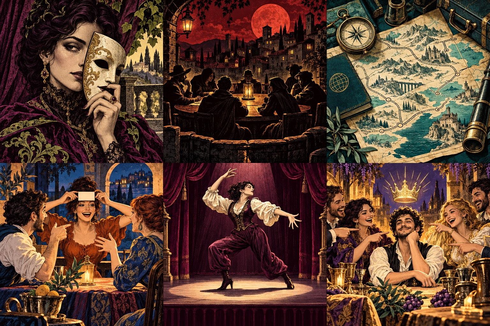
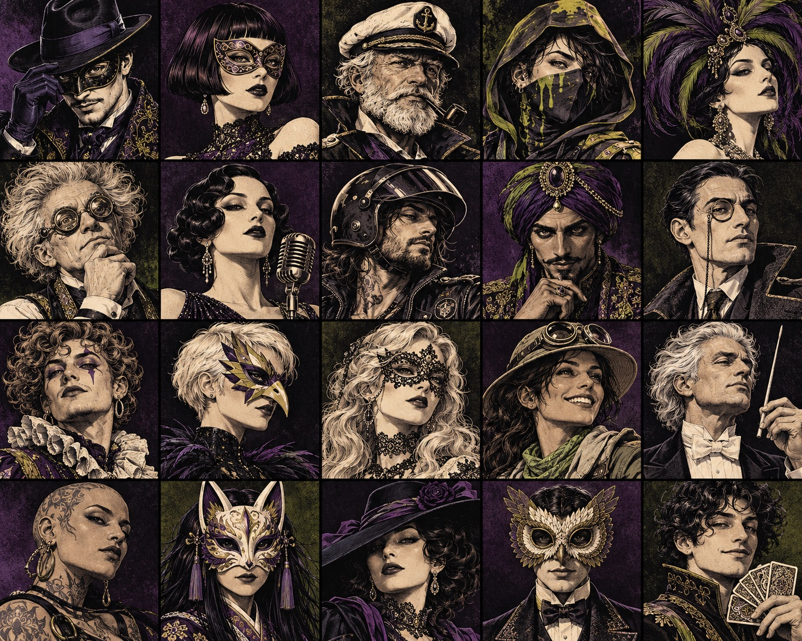

<div align="center">

# hudl n game.

### Good company. Bad alibis.

**One phone. Six game choices. Everyone in.**

[Play now](https://sayamdev.github.io/hudl-n-game/) · [How it works](#one-phone-a-whole-party) · [Run locally](#make-it-yours) · [AI setup](docs/pack-studio-setup.md)

Free to play · No accounts · No ads · Phone-first

</div>



## One phone. A whole party.

Add your crew, choose a game and pass the phone. A short interactive welcome lets new players practise holding to reveal a secret before the real round begins. Names, scores and custom packs stay on the device.

| Your kind of chaos                      | The game                                                                                   | Crew |
| --------------------------------------- | ------------------------------------------------------------------------------------------ | ---- |
| A word everyone knows. Almost everyone. | **Imposter** — secret words, clues, accusations and a last-chance guess.                   | 3–20 |
| Trust nobody after dark.                | **Mafia** — narrated nights, secret roles and village votes.                               | 5–20 |
| Same place. One very lost spy.          | **Where Are We?** — location clues, questioning and a hidden outsider.                     | 3–20 |
| Big gestures. Absolutely no words.      | **Heads Up!** — hold the screen up while your team gives clues. | 3–20 |
| You know exactly who it is.             | **Most Likely To / Hot Takes** — point votes or private agreement ratings.                 | 3–20 |

Heads Up and **Charades** have separate game cards. Choose Charades for silent acting with private actor prompts and at least four players.

## A little character. A lot of replay.

<table>
<tr>
<td width="33%"></td>
<td width="33%"></td>
<td width="33%"></td>
</tr>
<tr><td><b>The council.</b> Narrated nights, dawn reports and village votes.</td><td><b>The investigation.</b> A map desk and named question turns.</td><td><b>The stage.</b> Private prompts and silent acting.</td></tr>
</table>

<details><summary>Meet the twenty illustrated alibis</summary>



Each saved alibi keeps its character across the crew list, private handoff and results. Portraits never depend on secret roles.

</details>

- **Five visual worlds:** acid-green suspicion, midnight Mafia, a green spy world, coral charades and a yellow-and-purple voting party.
- **Private reveals:** swipe up in Imposter, then hide before passing to the named player. Hold-to-peek remains available in Settings and other games. Switching away hides secrets; returning games resume paused.
- **Less repetition:** local play history helps rotate words, prompts and secret roles. Small pools can still repeat; this is not a promise of endless unique content.
- **Make your own night:** mix curated words offline, write an original pack, or import one with a link or QR code. Review shared content before playing.
- **Browser comfort:** large touch controls, keyboard paths, reduced motion, light/dark modes, optional sound and installable PWA support. Once cached, the core games work offline.
- **Choose your look:** the earlier designs remain available in Settings.

## Play with touch, tilt or keyboard

In **Heads Up!**, choose **Enable tilt controls** before starting and allow motion access if your browser asks. Practise on the ready screen: hold upright, tip the screen toward the floor for Correct, or toward the ceiling to Skip. Return upright between gestures. Practice does not add points; touch controls remain available if sensors are unsupported or permission is denied.

- **Tab / Shift+Tab:** move between controls; **Enter / Space:** activate a button.
- **Hold Space or Enter on Hold to peek:** reveal your secret; release to hide it immediately.
- **→ / ← in Heads Up!:** Correct / Skip.
- **Esc:** pause a game; dismiss the pause dialog to resume.

Motion support depends on the device and browser. Sensor behaviour is covered by simulated browser events; physical iOS/Android verification is still needed. [Control design and API references](docs/adr/0004-phone-tilt.md).

## Keep the party moving

Imposter defaults to a quick group vote: point together, then tap the accused. Secret pass-and-vote is available in setup. The sealed verdict opens with a swipe or a button, with no forced countdown. Easier hint words give imposters a familiar association—Pizza → Cheese—alongside the category; category-only hints remain available for a harder round.

Choose **No timer** to play at your own pace. **Play Charades** starts classic silent acting for two teams of at least four people: privately check the prompt, hide it, then act. Correct/Skip passes the next prompt to another actor; timed games pause for these handoffs. Heads Up remains available as the other play style.

## Voices, tension and fresh words

**Settings → Voice studio** previews two fictional British-English hosts generated locally through VoiceStudio and its Qwen voice-design engine. Public Mafia instructions use bundled recordings, cached for offline play; no runtime AI subscription or model download is needed. Private roles and secret words are never spoken. The exact night report stays on screen.

The optional countdown soundtrack builds from gentle pulses to a faster final ten seconds, changing at one minute and thirty seconds. Pause or leave the game to stop it; **Sound effects**, **Volume** and **Countdown soundtrack** control it.

There are 1,289 family-friendly entries across 15 starter categories, including 150 celebrity names, plus a separately gated adult pack. There is no round quota. Unseen words come first, then older words recycle. **Packs → Add another batch** grows a draft without duplicate words; save more packs to expand your collection. Offline content is finite and free AI services have limits—the app does not promise infinitely many unique words.

## Make it yours

Use Node.js 22.12 or newer.

```sh
npm ci
npm run dev
```

For a production preview:

```sh
npm run build
npm run preview
```

Open the URL printed by Vite. Use its Network URL for a phone on the same Wi-Fi. Features such as service workers, device motion and wake lock depend on browser support and may require HTTPS.

### Optional AI, with a review step

The **public GitHub Pages demo uses the offline mixer and manual packs**. It does not expose an API key or run a generation server.

For local AI generation, copy `.env.example` to `.env.local`, add your own Groq key and confirm the account's free-tier configuration. Restart Vite. The server adapter requests a themed draft, validates it and returns it for you to edit before saving. Your crew names and scores are not included in the request.

The adapter has small in-memory usage caps and no paid fallback. Provider availability and free quotas can change. A public AI service needs separate server hosting and durable abuse controls; see the [setup and deployment notes](docs/pack-studio-setup.md). Never put secrets in a `VITE_` variable or commit `.env.local`.

## Under the hood

**React · TypeScript · Vite · Zustand · Motion · Lottie · Playwright · Vitest**

Lazy-loaded game screens share a typed session store. Content and scores persist locally; bounded variety history influences future rounds. The optional Node server keeps provider credentials out of browser bundles. The PWA caches the static app, not AI responses.

```sh
npm test                 # Game logic, content and variety
npm run test:server      # Provider adapter validation and limits
npm run test:e2e         # Production-preview browser journeys
```

Browser tests use installed Google Chrome and start/reuse a preview at port 4173. The repository workflow runs unit/server checks and publishes a static build to GitHub Pages. Browser verification is documented separately; it is not claimed as part of that workflow.

[Architecture](CONTEXT.md) · [Design system](DESIGN.md) · [Asset credits](docs/ASSETS.md) · [Release checks](docs/verification/welcome-release.md)

## Privacy and credits

No accounts, analytics or tracking cookies are built into the app. Browser storage holds the party data; clearing it removes the saved crew, packs and scores. Optional AI sends the theme, batch size and up to 48 recent studio words to the configured provider to discourage repeats. Player identities, roles and active secrets are not sent. Shared links carry the custom pack in the URL fragment.

Created by **[Sayam](https://github.com/SayamDev)**. Source code is [MIT licensed](LICENSE); fonts and icon assets retain their own licences. © 2026 Sayam.

**After Hours** brings an illustrated midnight deck, condensed display type and twenty distinct illustrated characters. Private cards fan into place, public verdicts lift away, and the winning crew lands together. The hold control stays stationary and releasing it removes secret text immediately. Switch back under **Settings → After Hours art & motion** without changing party data.

The illustrated deck, character cast and game-world scenes were generated for this project; earlier alibi emblems retain their CC BY credits. All artwork and fonts are served locally. [Art sources and licences](docs/art-after-hours.md) · [Design and verification notes](docs/verification/after-hours-review.md)

Every new game and replay checks who is in the crew, and game setup includes **Edit crew**. For face-to-face accusations, choose **Out loud — tap the accused**, or use **We voted out loud** during Imposter discussion/private voting. One person selects the accused; no individual phone ballots are required. Secret voting remains available.

Imposter supports swipe up to reveal and swipe down to conceal, with native button controls as alternatives. Each saved alibi now has a distinct portrait. Game-specific scenes and interaction framing distinguish the Mafia council, location investigation, team guessing board and silent stage. [Artwork provenance](docs/art-after-hours.md).
